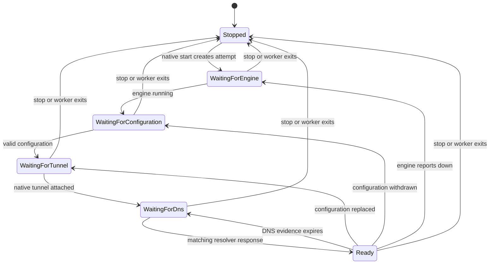
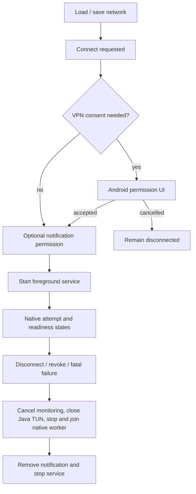

# Connection state and user experience

Status: baseline source review of `fe65654`, 2026-11-15. The baseline below
describes that revision; the later [adaptive UI implementation](adaptive-ui.md)
implements part of this proposal and documents remaining acceptance gaps.
This is a broad interaction/failure inventory, not a claim that every platform
or device edge case has been reproduced. Source sharing is the first publication
stage; see [source sharing](source-sharing.md).

## What the current state machine actually represents

The six Rust states describe the next unmet prerequisite for one attempt. They
are not the complete Android session lifecycle, underlay connectivity, or health
of every peer/application. JNI API version 4 exposes them as integer codes.

| Code / state | Required facts | Current presentation |
| --- | --- | --- |
| 0 / Stopped | Attempt inactive | Not connected |
| 1 / WaitingForEngine | Attempt active, engine not running | Starting engine |
| 2 / WaitingForConfiguration | Engine running, no accepted configuration | Waiting for network configuration |
| 3 / WaitingForTunnel | Configuration accepted, tunnel not attached | Network configured; Android tunnel pending |
| 4 / WaitingForDns | Engine, configuration and tunnel ready; probe not ready | IP transport ready; DNS pending |
| 5 / Ready | All prerequisites and internal DNS probe ready | VPN and DNS ready |

The diagram abbreviates prerequisite loss: any active downstream state can
regress to the first missing prerequisite. A new attempt clears every observation
and increments its generation. Old/stopped-attempt observations are rejected;
asserting tunnel or DNS readiness before its prerequisite is rejected too.
Losing engine/configuration/tunnel clears downstream facts. Root connectivity is
separate: losing roots alone does not invalidate an established peer path.

DNS evidence is one matching UDP SOA response from the first eligible managed
resolver, through the native packet adapter. NOERROR and NXDOMAIN responses are
accepted; this proves a resolver answered, not that an arbitrary name exists.
Healthy probes run at roughly 15 seconds, unhealthy probes at 2 seconds; evidence
expires after more than 30 seconds without a valid response. These are code
intervals, not measured UI convergence or cold-start guarantees. There is no
implemented failover to later configured resolvers. With no usable managed DNS,
IP transport can work while readiness remains WaitingForDns indefinitely.

Crucially, the probe bypasses the Android TUN. State 5 does **not** establish that
Android resolver policy, Firefox, another peer, HTTPS, authentication, IPv4 and
IPv6 all work. The existing Android IPv6 resolver compatibility route addresses
one observed application-DNS issue; it does not change this evidence boundary.

## Android lifecycle around those states

The notification permission request in this diagram is the main Activity path;
the tile's private activity prepares VPN consent but does not request notification
permission. Denial in the main path still proceeds to VPN startup.

The service checks VPN preparation, protects its IPv4/optional IPv6 UDP sockets,
starts the core, and checks configuration every 500 ms. Builder installs validated
addresses, non-default routes and DNS. Java owns a TUN descriptor; Rust owns a
duplicate, with configuration revisions guarding attachment. Configuration
replacement drops the old native TUN and downstream readiness before rebuilding.

Explicit cleanup is serialized and idempotent; service destruction is only a
fallback. Native stop marks the attempt inactive **before** joining its worker.
Thus current code 0 is not a shutdown-complete acknowledgement. Closing the app
screen removes the 1-second UI poll; it does not request VPN shutdown. The service
uses START_NOT_STICKY; always-on support is disabled and process-restart recovery
is not implemented. Android VPN consent, revocation and foreground lifetime must
remain Android-owned ([VPN lifecycle](https://developer.android.com/develop/connectivity/vpn)).

## Observability and interaction gaps found in source

These are source-review findings and risks; they are not all reproduced bugs.

| Gap | Consequence | Proposed improvement |
| --- | --- | --- |
| Connect is not latched while consent/startup is pending | Repeated taps or a tile/app race can create competing requests | One serialized command owner; explicit pending command and attempt token |
| No Rust/Android state for consent, stopping or cleanup completion | UI can offer Connect before the prior service is fully released | Represent lifecycle separately; acknowledge teardown before Disconnected |
| Service retains closing/cleaned flags until destruction | A bound service reused during stop/start can reject a new start | Define tested same-instance restart or wait for a fresh service; never reset flags while cleanup runs |
| Main permission callbacks have no command-generation guard | A late consent/notification result can start after intent has changed | Ignore cancelled/obsolete results across every entry point |
| Failure cleanup clears native errors and may replace them with a generic Android VPN error | The original storage/transport/controller cause can disappear | Preserve first meaningful typed cause and teardown result separately |
| Error strings are separate from the six states | Pending admission, unknown network and terminal failure look too similar | Structured reasons and explicit actions; no parsing localized strings |
| Main reads multiple JNI getters independently | One screen can combine facts from different revisions | One immutable snapshot with attempt, revision and timestamps |
| UI stage rows use numeric state comparisons | Stopped or failed stages all look merely “Not ready” | Render applicable facts, pending stages, failures and unknowns distinctly |
| No ConnectivityManager callback or underlay binding/selection model | No reliable offline/handover label; socket recovery depends on Android/core behavior | Observe non-VPN networks and version underlay updates |
| Tile samples only when panel listening starts | A visible tile can remain stale through connect, degradation or stop | Refresh from shared snapshots while listening; no new polling loop |
| Notification is static “running” text | Notification, tile and Activity can disagree | Derive all three from the same presentation snapshot |
| Main settings readiness does not mean a valid saved network exists | Connect can be offered with empty/unsaved settings | Separate loaded, saved, valid and edited; setup action until saved |
| The tile and main screen have different consent flows | Inconsistent permission explanations and recovery | Share the command coordinator; retain thin Android entry points |

Sources: [readiness](../crates/core/src/readiness.rs),
[engine](../crates/core/src/engine/native.rs), [packet adapter](../crates/core/src/packet.rs),
[main screen](../android/app/src/main/java/org/rcouto/zeroute/MainActivity.java),
[VPN service](../android/app/src/main/java/org/rcouto/zeroute/ZerouteVpnService.java),
[tile](../android/app/src/main/java/org/rcouto/zeroute/ZerouteTileService.java), and
[tile control activity](../android/app/src/main/java/org/rcouto/zeroute/VpnControlActivity.java).

## Proposed state contract

Keep independent facts instead of making every combination a new state:

| Dimension | Proposed facts |
| --- | --- |
| User intent | Off / on; command ID; explicit cancellation |
| Session lifecycle | Idle, awaiting consent, starting, running, stopping, failed |
| Underlay | Unknown, absent, available, changing; actual selected network identity, transport set, capabilities, metered/roaming flags |
| ZeroTier | Engine facts, roots, admission/configuration reason, attempt and revision |
| Android tunnel | Absent, establishing, attached, tearing down; attachment revision |
| Health evidence | Resolver response and age; optional Android lookup and selected-peer evidence kept distinct |
| Failure | Typed cause, recoverability, last transition time; no keys or private traffic |

Rust should own desired intent, transition/retry policy and presentation semantics.
The Android adapter reports consent, service/TUN lifecycle and connectivity facts;
it performs framework operations without duplicating policy. One snapshot crosses
JNI. Native-attempt generations already exist; extend command/callback scoping
across the Android boundary rather than replacing that protection.

Proposed invariants:

- Explicit Disconnect wins over outstanding startup, consent, retry and handover.
- Repeated Connect/Disconnect commands are idempotent. A cancelled attempt cannot
  revive after permission acceptance, screen rotation or a delayed callback.
- Disconnected means cleanup has acknowledged no owned native transport/TUN;
  while waiting, show Disconnecting. A teardown failure is visible, not success.
- No stale callback, old configuration attachment or old probe can promote a new
  attempt. New underlay/configuration revisions invalidate dependent evidence.
- Roots unavailable is diagnostic unless usable transport evidence is also lost.
- Loss of Internet validation is not by itself proof that private overlay access
  is impossible. No route, captive portal, UDP failure and resolver failure differ.
- Do not silently change to full-tunnel routing, install a kill switch, regenerate
  an identity, switch network IDs, or automatically retry after explicit revocation.
- All entry points agree on intent, lifecycle and actionable error; timing alone
  cannot promote a connection to Ready.

## Proposed screen, tile and notification

| Presentation | Meaning / primary action |
| --- | --- |
| Set up network | No validated saved network; Save network |
| Disconnected | No owned session resources; Connect |
| Permission required | Explain Android consent; Continue or cancel |
| Connecting | Show current prerequisite and elapsed time; Cancel |
| Waiting for network | Intent on, no usable underlay; Disconnect |
| Network sign-in needed | Captive-portal evidence; Open Android sign-in, Disconnect |
| Awaiting authorization | Controller explicitly denies admission; Copy public node ID, Disconnect |
| Reconnecting | Underlay/configuration transition with intent still on; Disconnect |
| Private network connected | TUN attached and current internal resolver evidence; Disconnect |
| Connected — DNS unavailable | TUN attached but resolver evidence missing/expired; Retry diagnostics, Disconnect |
| Connected — DNS not configured | Valid IP-only network; do not spin forever waiting for a nonexistent resolver |
| Connection failed | Typed cause and next step; Retry or Edit settings |
| Disconnecting | Resource teardown pending; avoid a new connection racing cleanup |

“Private network connected” needs a short explanation: private routes only;
Internet traffic normally uses the underlying network. Resolver and selected-peer
results belong in diagnostics, not an unqualified promise that all apps work.
Disconnected must not promise that private sites become inaccessible: LAN routes,
other profiles/proxies, DNS/browser caches and persistent connections can differ.

The tile's active state should mean session requested/running, with a subtitle
for Connecting, Waiting for network, DNS unavailable or Connected. Failed/stopped
is inactive; native/API unavailability is unavailable. An active tile must still
allow Disconnect during degraded operation. Refresh during the listening lifetime
and on relevant state changes, and re-read on the next bind. Follow Android's
[TileService lifecycle](https://developer.android.com/reference/android/service/quicksettings/TileService);
do not keep a service alive merely to paint the panel. Long press should open
connection details. Locked-device actions must respect Android unlock/consent.

Use large text/touch targets, explicit labels and contrast without relying on
color. On e-ink, update only changed text, avoid animated spinners and counters
on the main screen, and preserve focus/scroll/unsaved edits on refresh. Show stage
age rather than an invented progress percentage. After a reviewed timeout,
explain the delay without claiming a cause; timeout thresholds remain unmeasured.

## Adaptive Android UI contract

One shared layout and state vocabulary must work across supported Android devices.
Device names must not select layouts, themes or behavior. The current APK is
ARM64-only and the minimum SDK is API 26; adaptive UI intent does not claim other
ABIs or every Android/OEM combination is tested.

- Use current window size, not phone model or physical screen size. Support narrow
  windows, tablets, foldables, portrait/landscape and split screen. Reflow detail
  groups when space permits; keep one obvious primary connection action.
- Follow system font/display scaling without clipping or truncating essential
  state, errors or actions. Text can wrap; the actual app must scroll when needed.
  Do not constrain screens to a fixed height. Test large text up to 200% and
  window resizing, including a narrower-than-phone multi-window case.
- Follow system light/dark appearance. High contrast is an optional display
  preference available to everyone, including LCD, OLED and e-ink users. Preserve
  the same layout, commands and status semantics when it is enabled.
- Avoid gratuitous animation by default and respect system reduced-animation
  preferences. Update changed status text only; do not create a separate e-ink UI.
- Respect system bars, cutouts, gesture navigation and IME insets. Rotation,
  resizing and keyboard visibility must not hide the action or discard edits.
- Support TalkBack, descriptive state/action labels, keyboard/switch navigation,
  RTL and longer translated strings. Use at least 48dp interaction targets;
  never rely solely on color, vibration or animation to communicate state.
- Treat phones used during development as acceptance samples. Compatibility
  coverage must name tested API/window/accessibility conditions, not promise
  universal device validation. No new ABI or emulator CI is introduced here.

The interactive review uses one Adaptive app design and a separate Quick Settings
view. High contrast changes presentation rather than selecting a device variant;
preview window width and Android text scale are review controls, not new app
settings. These remain proposals, not installed app behavior.

## Interaction and lifecycle edge-case matrix

Every desired outcome here is proposed acceptance behavior, not current proof.

| Situation | Required experience / acceptance condition |
| --- | --- |
| First launch; no settings | Setup is visible; Connect cannot silently start with empty settings |
| Invalid ID, whitespace, paste, save error | Preserve input and focus; specific validation; no engine starts |
| Edited but unsaved ID; tile used meanwhile | Connect saved identity/network only; clearly identify unsaved edit |
| Network change while connected | Require explicit disconnect/save/reconnect; no hidden live migration |
| Save races with tile Connect | Serialize save/start; accepted snapshot identifies which saved network starts |
| Double tap Connect; app and tile simultaneous | One logical attempt and permission flow; no duplicate engine |
| Cancel consent, Back, notification denial | No unintended startup after cancellation; notification denial is explained separately |
| Rotate or background during consent/save/start | Preserve pending request and edits; no duplicate dialogs or engine |
| Disconnect before permission result or before native attempt exists | Cancel command; late callbacks cannot start it |
| Disconnect during configuration/TUN rebuild or retry | Cancellation wins and eventually acknowledges full cleanup |
| Connect while stopping or service still bound | Wait for teardown acknowledgement; no dead service or dropped command |
| App closed, screen off, lock/unlock | UI lifecycle does not change session intent; show current facts on return |
| Tile removed/added; panel open during transitions | No session side effect; immediate snapshot when listening resumes |
| Notification blocked; Stop from notification/system settings | Explain notification availability; every stop path tears down consistently |
| Another VPN takes over; preparation revoked | Show external revocation and stop; do not fight the other VPN automatically |
| Always-on/lockdown managed by another app or device policy | Report Android restriction; no claim to override policy |
| Force stop, OS kill, reboot, update | Honor current no-auto-restart policy; reconcile actual state on next entry |
| Native load/ABI failure, worker panic, FD exhaustion | Visible error and safe cleanup; tile unavailable where appropriate |
| Storage full, identity unreadable, data cleared/reinstall | Fail safely; never quietly replace a readable existing identity; explain new enrollment after data loss |
| Multiple Android users/work profile | Scope app identity and Android VPN ownership to the correct profile |
| Process/activity restoration while permission outstanding | Restore a pending command only with its generation/intent; no phantom permission wait |

## Underlay and backend edge-case matrix

The implementation currently has protected wildcard UDP sockets but no Android
network callback/binding policy. These are required design/test cases, not claims
that current handover handling is broken or already fixed. Track networks by
identity and capabilities, not SSID, a Wi-Fi icon, or the VPN network itself.
Android documents that network identities change on reconnection and recommends
callbacks for changes ([network state](https://developer.android.com/develop/connectivity/network-ops/reading-network-state)).

| Situation | Required experience / acceptance condition |
| --- | --- |
| Wi-Fi connected, no Internet or gateway | Differentiate link from usable path; retain intent and offer Disconnect |
| Airport/hotel captive portal | Explain sign-in; offer system portal UI without disabling protection silently |
| Wi-Fi to mobile and reverse; airplane mode | Observe replacement underlay; invalidate stale health and revalidate; never retry after user stopped |
| Wi-Fi and mobile both available | Show actual selected transport, not all available radios as active VPN paths |
| Ethernet/USB Ethernet plug/unplug, dock, USB tether upstream | Treat wired as a real underlay; removal can fall back to another allowed network |
| Phone provides hotspot/USB tethering | Do not confuse downstream sharing with VPN upstream; do not promise tethered clients inherit the phone VPN |
| Bluetooth tether/PAN or other transport | Generic network identity/capabilities path; no Wi-Fi/mobile-only assumptions |
| Same Wi-Fi name after reconnect; DHCP/default route/DNS change | New network/link revision; refresh routing and protected sockets as needed |
| IPv4-only, dual-stack, IPv6-only/NAT64/464XLAT; family loss | Report usable families; test core endpoint reachability and resolver policy independently |
| Metered mobile, roaming, data saver, OEM battery restrictions, Doze | Surface relevant constraints; bounded retries; no continuous high-cost polling or unsupported battery claims |
| Link flaps, simultaneous callbacks, VPN appears as default | Serialize facts; avoid selecting Zeroute as its own underlay or restart loops |
| UDP blocked, strict NAT, relay path, roots unreachable | Distinguish observations from diagnosis; direct/root/relay assumptions require evidence |
| Authorization pending, denied or later revoked | Use controller's explicit reason; copy public node ID; never label every timeout “awaiting approval” |
| Wrong/nonexistent network; invalid config, no assigned address | Specific actionable reason; no indefinite generic spinner |
| Core identity collision; corrupt persistent identity | Stop and explain; no automatic identity reset or key display |
| Controller changes addresses, routes, MTU or DNS mid-session | Revision-safe rebuild, scoped evidence invalidation and clear reconnecting state |
| First DNS fails; second works; DNS removed or NXDOMAIN | Separate configuration/response/name existence; design explicit resolver failover |
| Private DNS, browser secure DNS, conflicting search domains | Internal probe can succeed while app resolution fails; offer Android-path diagnosis |
| Root online but target peer not discovered/asleep/denied | Keep peer readiness separate; do not report whole VPN down or all peers healthy |
| Overlapping LAN/overlay prefixes; site reachable without VPN | Explain routing scope; use a verified exclusive destination for disconnect tests |
| Routes contain default/unsupported policy; TUN permission lost | Show ignored default-route policy; teardown on revocation; no silent full tunnel |
| Resolver reply expires during sleep or handover | Show evidence age/unknown until fresh proof; avoid a stale Ready badge |
| HTTPS certificate/authentication/app outage despite healthy transport | Report app-layer failure separately; do not reconnect the VPN reflexively |

## Delivery and validation boundaries

Recommended implementation order (proposal, not authorization):

1. Shared snapshot and serialized command/consent/stop contract, preserving typed
   causes and making Disconnect completion explicit. Exercise stop/start and late
   callback races before cosmetic changes.
2. Event-driven underlay observations and reconnection policy; determine whether
   protected sockets need rebinding/recreation from measured transitions.
3. Consistent Activity/tile/notification presentation, copy-node action and
   one accessible adaptive layout with optional high contrast; separate IP-only,
   resolver and peer evidence.
4. Source-sharing preparation independently of APK distribution.

Future validation should cover transition invariants in Rust, Android lifecycle
and permission ordering, and real-device transport changes. Pair off/on/off
checks with fresh connections and verified exclusive targets; document which
transport/profile each observation belongs to. Backend evidence alone cannot
establish Android browser reachability. Record measured stage durations rather
than treating probe periods as performance benchmarks.

This review adds documentation only: no jobs, dependencies, timers, builds or
phone changes. Any implementation that adds CI work needs a separate cost/cache
agreement. Prefer the existing host and ARM64 checks; emulator jobs and release
pipelines remain outside this proposal.
